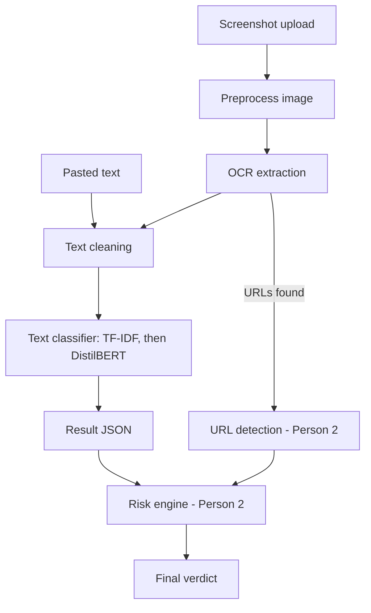

# Workflow

## Text path
Pasted text is cleaned (lowercase, strip noise), classified, and returned
as a result JSON with score, verdict, scam type and reasons.

## Screenshot path
The image is preprocessed (resize, denoise) and run through OCR. The
extracted text joins the text path at the cleaning step. Any URLs found are
passed to Person 2's URL module.

## Handoffs to Person 2
- URLs found in either input go to URL detection.
- The result JSON goes to the risk engine, which combines it with the URL
  score into the final verdict.
